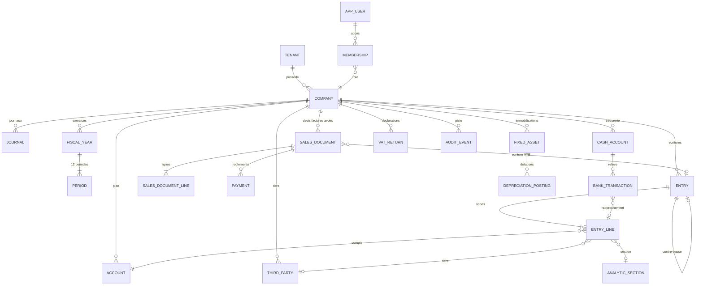

# 04 · Modèle de données

Le script complet est dans [`schema.sql`](schema.sql) (PostgreSQL 15+). Principes :

- **Multi-tenant** : chaque table métier porte `company_id` ; isolation par **Row Level Security** (`app.company_id` positionné par l'API à chaque transaction). Un cabinet ou un groupe = un `tenant` qui possède plusieurs sociétés.
- **Montants** en `BIGINT` (francs CFA entiers). Aucun `NUMERIC` à décimales sur les montants comptables.
- **Intangibilité** garantie en base : triggers interdisant la modification et la suppression des écritures validées et de leurs lignes (hors colonnes de lettrage, de rapprochement et de section analytique).
- **Équilibre** vérifié par trigger différé au `COMMIT` : une écriture validée dont débit ≠ crédit fait échouer la transaction.
- **Numérotation** par table `journal_sequence (company, journal, year)` verrouillée `FOR UPDATE` pendant la validation : continuité garantie même en concurrence.
- **Audit** en ajout seul, chaîné par SHA-256.

## Diagramme

## Correspondance avec l'état du prototype

| Prototype (`S.data[cid]`) | Table(s) |
|---|---|
| `companies[]` | `company` |
| `accounts[]` | `account` |
| `journals[]` (+ `seq`) | `journal`, `journal_sequence` |
| `taxCodes[]` | `tax_code` |
| `sections[]`, `keys[]`, `budgets` | `analytic_section`, `allocation_key`, `allocation_key_share`, `analytic_budget` |
| `fiscalYears[]` (+ `locked`) | `fiscal_year`, `period` |
| `tiers[]` | `third_party` |
| `entries[]` (+ `lines`) | `entry`, `entry_line`, `attachment` |
| `items[]`, `docs[]` (+ `payments`) | `item`, `sales_document`, `sales_document_line`, `payment` |
| `bankAccounts[]`, `bankTx[]`, `bankRules[]`, `cashCounts[]` | `cash_account`, `bank_transaction`, `bank_rule`, `cash_count` |
| `assets[]` (+ `posted`) | `fixed_asset`, `depreciation_posting` |
| `vat{}` | `vat_return` |
| `closing{}` (reint, deduct, isNum, anNum, affNum, dsf) | `closing`, `tax_adjustment` |
| `audit[]` | `audit_event` |
| `settings` | `company_setting` (clé / valeur JSONB versionnée) |
| `importLog[]` | `import_job` |
| `S.users[]` | `app_user`, `membership` |

## Index indispensables

- `entry (company_id, date)`, `entry (company_id, journal_code, number)` unique partiel `WHERE status='validated'`.
- `entry_line (company_id, account_num)`, `(company_id, third_party_id) WHERE letter IS NULL` (lettrage, balance âgée).
- `bank_transaction (cash_account_id, status, date)`, unique `(cash_account_id, dedup_key)`.
- `audit_event (company_id, id)`.

## Vues et agrégats

- `v_trial_balance(company, year, to)` : balance 6 colonnes.
- Pour les gros volumes, table `account_balance_month (company, account, year, month, debit, credit)` alimentée par trigger à la validation : les balances et états se calculent sur les cumuls mensuels + le mois courant.
